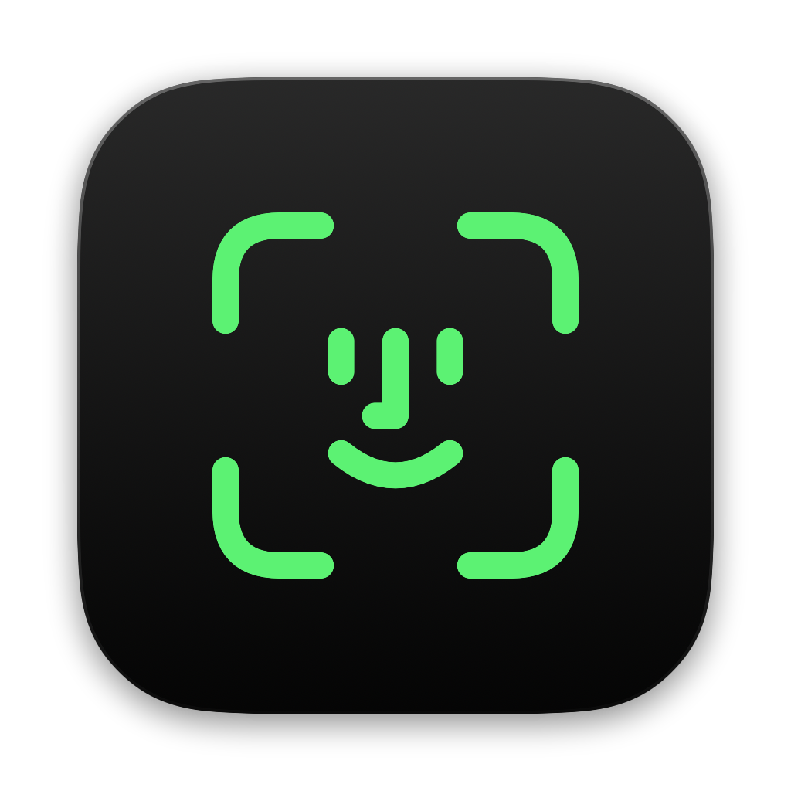
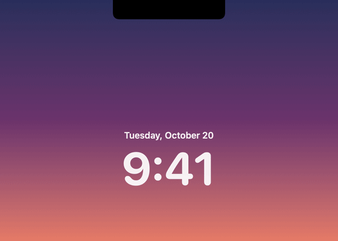
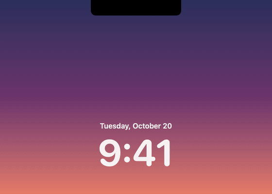

<p align="center">
  
</p>

<h1 align="center">NotchUnlock</h1>

<p align="center">
  Unlock your Mac with your face, like Face ID on iPhone.<br>
  A panel drops from the notch, the rings spin, and you're in.
</p>

<table align="center">
  <tr>
    <td align="center"></td>
    <td align="center"></td>
  </tr>
  <tr>
    <td align="center"><sub>Recognized: the rings settle, the face appears, and the Mac unlocks</sub></td>
    <td align="center"><sub>Not recognized: the rings turn red and the panel shakes</sub></td>
  </tr>
</table>

---

## Features

### Face ID from the notch
- When your Mac is locked, a black panel drops from the notch with an iPhone-style Face ID animation: two green rings spin in 3D, then slow down smoothly until they merge into one circle and the face appears.
- On failure the rings turn red and the panel shakes, like a wrong passcode.
- The panel shows **on top of the lock screen**, and the animation runs at the display's native refresh rate (120 Hz on ProMotion).

### Click to unlock
- **A preview first**: when the Mac is locked, a small Face ID glyph appears beside the notch. The camera stays off.
- **Click to open**: click the preview and the panel opens and starts scanning.
- Once your face is recognized, NotchUnlock types your login password for you. If it fails, the panel folds back into the preview, ready for another try.

### On-device recognition
- Face detection with Vision, 5-point alignment (eyes, nose, mouth corners) and an **SFace** face recognition model running in Core ML.
- To unlock, both the closest enrolled sample and the average of all samples must agree, across **several consecutive frames**: one "lucky" frame is not enough.
- Faces that are too small or turned too far are ignored, since they are the main source of false matches.
- If it is clearly someone else, the attempt is rejected right away instead of waiting for the scan to time out.

### Photo protection
- Identity alone is not enough: it also needs proof of life, either a **blink** or the natural **micro-movements** of a face.
- Movement is measured relative to the face, so moving a printed photo around or closer to the camera does not count.
- Configurable modes: off, blink, motion, blink *or* motion (default), blink *and* motion.

### Guided enrollment
- Apple-style setup: a live camera preview in a circle, surrounded by tick marks that turn green as you complete each pose.
- Five guided poses (look straight, turn left, turn right, tilt left, tilt right), with live instructions and hints.
- The recognition threshold is **calibrated automatically** from your samples.

### Privacy
- Everything happens on your Mac: no servers, no network connections.
- Face data is stored in `~/Library/Application Support/FaceMac/`, and the password in the macOS **Keychain**.
- The camera turns off after a few seconds without a match, so the green light doesn't stay on.
- The display doesn't dim while scanning.
- One button in Settings deletes your face and password.

### Unobtrusive
- Lives in the menu bar, with no Dock icon.
- Speaks your Mac's language: English and Italian, picked automatically from your system settings.
- Asks for every permission it needs (camera and Accessibility) on first launch.
- On first launch it opens Settings with the guided setup.

## Requirements

- macOS 14 Sonoma or later
- A Mac with a camera (the panel is designed for Macs with a notch; on others it appears at the top center of the main display)
- To build from source: Xcode or the Swift command line tools

## Download

1. Download the `NotchUnlock-x.y.zip` file from the [latest release](https://github.com/Bargi20/NotchUnlock/releases/latest). It runs on both Apple silicon and Intel Macs.
2. Unzip it and drag **NotchUnlock** into your **Applications** folder.
3. Open it. The app is not notarized by Apple, so the first time macOS blocks it with a warning. Go to **System Settings → Privacy & Security**, scroll down and click **Open Anyway**, then confirm.

## Build from source

```bash
git clone https://github.com/Bargi20/NotchUnlock.git
cd NotchUnlock
./build-app.sh
```

The script builds a release version of the app and installs it in `/Applications/NotchUnlock.app`. Use `./build-app.sh --dist` to build a universal zip in `dist/` instead, and `Tools/make-demo.sh` to regenerate the demo GIFs above from the app's real animation (needs `ffmpeg`).

## First launch

1. **Camera**: allow access when macOS asks.
2. **Accessibility**: turn it on in System Settings → Privacy & Security → Accessibility. It is needed to type your password.
3. **Password**: enter your Mac login password in the app's Settings. It is saved in your Keychain.
4. **Face**: click "Set Up NotchUnlock…" and follow the instructions.

## Limitations

> **Convenience, not security.** NotchUnlock uses the regular 2D camera, not a depth sensor like Face ID. Photo protection lowers the risk, but it is not comparable to the security of Face ID or Touch ID.

- It only works once you are logged in: after a restart, or at the first login with FileVault, you need your password.
- The app is signed locally (ad hoc) and not notarized, so macOS warns you the first time you open it, and may ask for permissions again after each update.

## Credits

- Recognition engine derived from [FaceMac](https://github.com/c1osed1/FaceMac) by c1osed1 (GPL-3.0).
- Window above the lock screen via [SkyLightWindow](https://github.com/Lakr233/SkyLightWindow) by Lakr Aream (MIT).
- **SFace** face recognition model from [OpenCV Zoo](https://github.com/opencv/opencv_zoo/tree/main/models/face_recognition_sface) (Apache-2.0), converted to Core ML. Details in [`NOTICE`](NOTICE).

## License

NotchUnlock is free software released under the **GNU GPL v3.0**, the same license as FaceMac, which it is derived from: you can use, modify and redistribute it, as long as modified versions stay GPL-3.0 too. Full text in [`LICENSE`](LICENSE), third-party components in [`NOTICE`](NOTICE).
